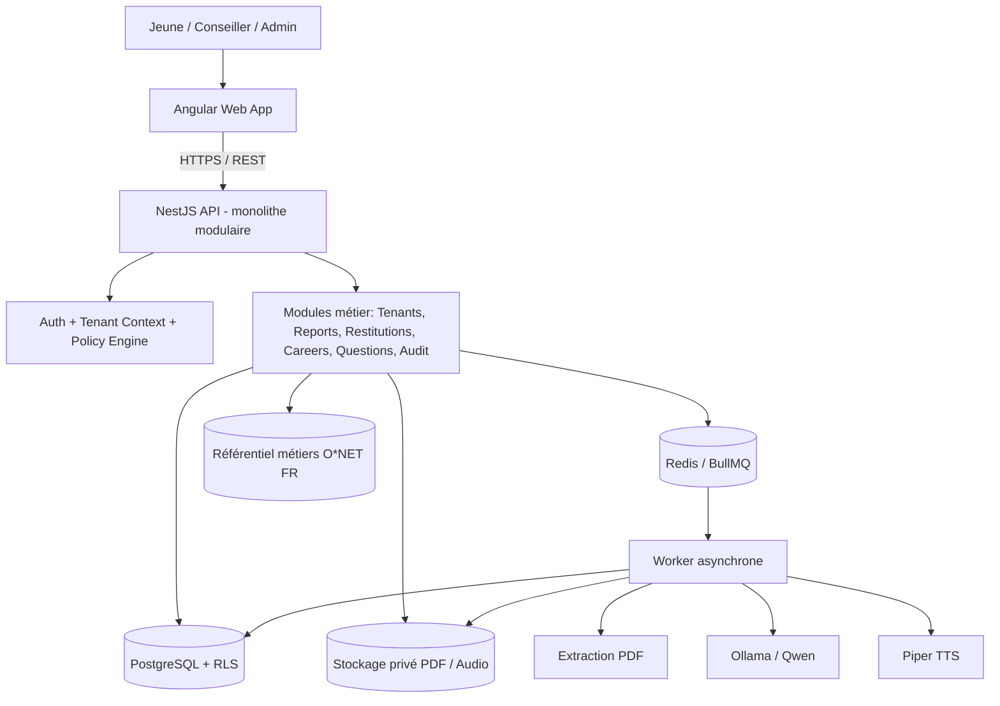
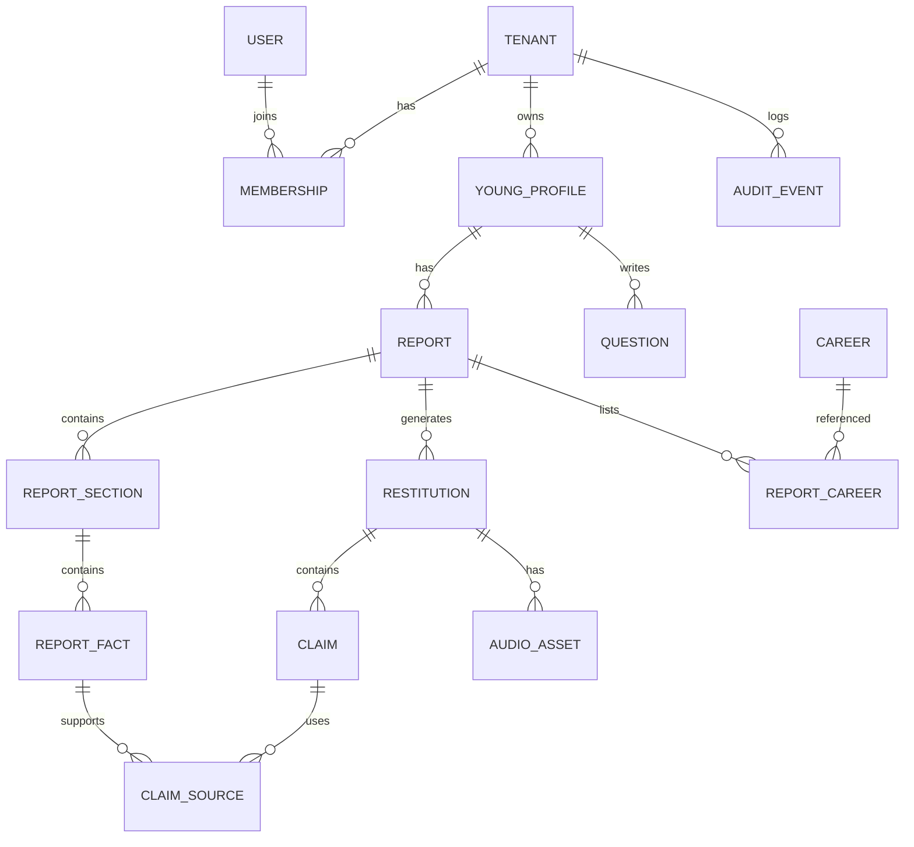
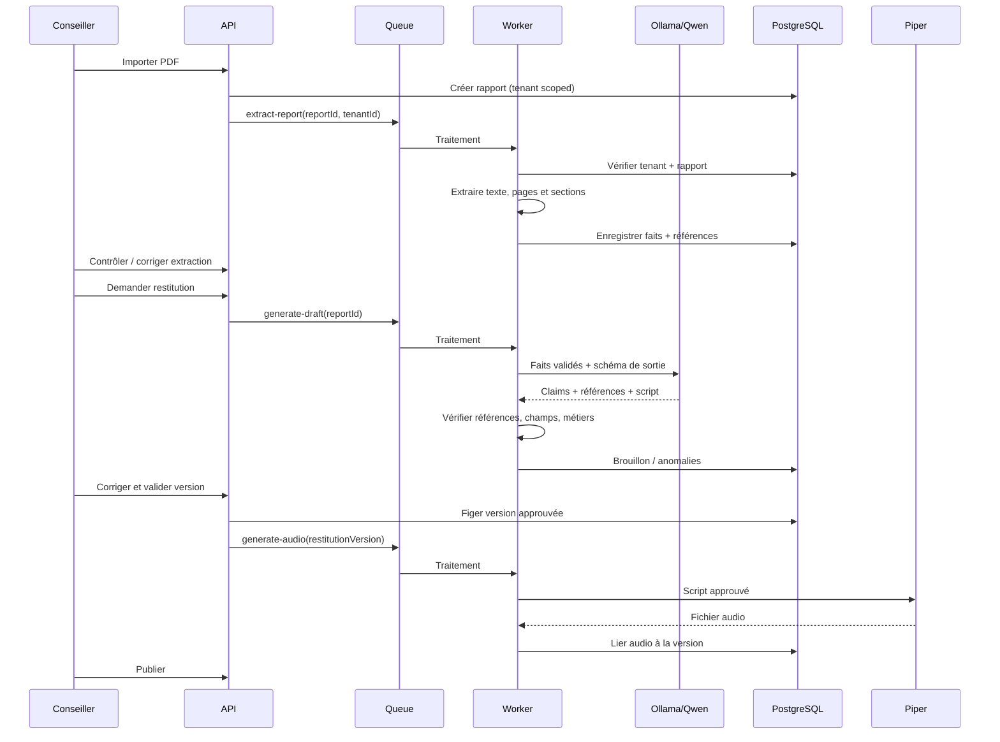

# MonBilan+ — Architecture technique

> **Statut :** architecture cible proposée · **Version :** 1.0 · **Date :** 18 novembre 2026  
> **Produit :** restitution accessible, audio et vérifiable de rapports d'orientation.  
> **Décision structurante :** monolithe modulaire multi-tenant, complété par des workers asynchrones.

## 1. Objectifs et principes

MonBilan+ permet à plusieurs établissements d'accompagner des jeunes à partir de rapports d'orientation existants. Un conseiller importe un PDF, contrôle les informations extraites, valide une restitution pédagogique sourcée, puis autorise sa publication et sa conversion en audio. Le jeune écoute, consulte les métiers proposés dans son rapport et prépare des questions pour son conseiller.

**Hors périmètre du MVP :** nouveau test d'orientation, diagnostic psychologique automatisé, recommandation de métiers inventée par le LLM, chatbot ouvert, enregistrement automatique des entretiens et vidéo générative.

Principes :

1. **Fidélité documentaire :** aucune affirmation personnelle sans donnée source vérifiable.
2. **Human-in-the-loop :** validation explicite du conseiller avant publication et audio.
3. **Isolation multi-tenant :** aucune fuite inter-établissements, y compris fichiers, tâches, caches et journaux.
4. **Privacy by design :** minimisation, droits d'accès, conservation limitée, données fictives pour la démonstration publique.
5. **Modularité :** domaines séparés ; dépendances orientées vers le domaine ; pas de microservices prématurés.
6. **Reproductibilité :** Docker, migrations, tests, CI et configuration documentée.
7. **Accessibilité :** parcours mobile, langage clair, transcription du contenu audio, navigation clavier.

## 2. Décisions d'architecture (ADR condensées)

| ID | Décision | Justification |
|---|---|---|
| ADR-001 | Monolithe modulaire NestJS | Transactions et déploiement simples, frontières métier testables |
| ADR-002 | Angular + TypeScript strict + Tailwind | Deux portails cohérents et composants réutilisables |
| ADR-003 | PostgreSQL + Prisma | Contraintes relationnelles, migrations, transactions |
| ADR-004 | Base partagée avec `tenant_id` + PostgreSQL RLS | Isolation renforcée pour les premiers pilotes ; tests indispensables |
| ADR-005 | Redis + BullMQ pour tâches longues | API non bloquante, reprises, idempotence et visibilité des états |
| ADR-006 | Ollama + Qwen via interface `LLMProvider` | Inférence locale et fournisseur remplaçable |
| ADR-007 | Piper TTS via interface `SpeechProvider` | Synthèse locale du script validé |
| ADR-008 | Stockage privé des PDF et audios | Pas de fichiers sensibles dans Git ou dans le répertoire public |
| ADR-009 | Pas de RAG/vector DB au MVP | Rapports structurés, preuves documentaires explicites |
| ADR-010 | Docker Compose en développement | Environnement reproductible ; Ollama natif sur Mac Apple Silicon si souhaité |

## 3. Vue d'ensemble



**Frontières de déploiement :** `web`, `api`, `worker`, `postgres`, `redis`, `storage` et moteurs IA/TTS. Plusieurs conteneurs **ne signifient pas** plusieurs microservices métier. L'API et le worker peuvent partager les bibliothèques métier tout en s'exécutant dans des processus séparés.

## 4. Domaines fonctionnels (bounded contexts)

| Domaine | Responsabilités | Entités principales |
|---|---|---|
| Identity & Access | Identité, adhésion, rôles, autorisations, sessions | User, Membership, Assignment |
| Tenancy | Établissements, paramètres, limites | Tenant, TenantSettings |
| Reports | Import, stockage, sections, faits et références | Report, ReportSection, ReportFact |
| Restitutions | Script, claims, versions, validation, publication | Restitution, Claim, ClaimSource, Review |
| Audio | TTS, statut, artefact versionné | AudioAsset |
| Careers | Catalogue O*NET FR, zones et associations | Career, ReportCareer |
| Questions | Carnet de questions du jeune | Question |
| Audit & Compliance | Événements d'accès, rétention, suppression | AuditEvent, RetentionPolicy |

**Règle :** un domaine n'accède pas directement aux tables privées d'un autre domaine via des raccourcis Prisma. Les échanges passent par des interfaces d'application explicites. Éviter de partager des entités ORM comme contrat public.

## 5. Structure du monorepo

```text
monbilan-plus/
├── apps/
│   ├── web/                         # Angular : espaces jeune, conseiller, admin
│   ├── api/                         # NestJS : HTTP, auth, cas d'usage
│   └── worker/                      # BullMQ : PDF, IA, TTS
├── packages/
│   ├── contracts/                   # OpenAPI, schémas DTO, types de messages
│   ├── domain/                      # Value objects et règles métier sans framework
│   ├── ai-adapters/                 # OllamaLLMProvider, SpeechProvider
│   └── config/                      # Validation des variables d'environnement
├── prisma/
│   ├── schema.prisma
│   └── migrations/
├── infrastructure/
│   ├── docker/
│   │   ├── web.Dockerfile
│   │   ├── api.Dockerfile
│   │   └── worker.Dockerfile
│   ├── compose.yaml
│   ├── compose.dev.yaml
│   └── monitoring/
├── tests/
│   ├── integration/
│   ├── e2e/
│   ├── tenancy/
│   └── security/
├── .github/workflows/ci.yml
├── .env.example
├── .gitignore
├── ARCHITECTURE.md
└── README.md
```

À l'intérieur d'un module métier NestJS :

```text
reports/
├── domain/             # Entités, invariants, ports de dépôt
├── application/        # Use cases, commandes, requêtes
├── infrastructure/     # Prisma, stockage, parseur PDF
└── presentation/       # Contrôleurs, DTO, validation HTTP
```

Les dépendances vont de `presentation` et `infrastructure` vers `application` et `domain`, jamais l'inverse. Le domaine n'importe ni NestJS, ni Prisma, ni Ollama.

## 6. Multi-tenancy et autorisation

### 6.1 Modèle de tenancy

- `User` : identité globale.
- `Tenant` : établissement indépendant.
- `Membership(user_id, tenant_id, role)` : un utilisateur peut appartenir à plusieurs établissements.
- `Assignment(tenant_id, counselor_id, young_profile_id)` : accès d'un conseiller aux dossiers qui lui sont attribués.
- Toutes les ressources métier privées portent `tenant_id NOT NULL` et des contraintes tenant-aware.
- Les données de référence O*NET sont globales et en lecture seule ; les sélections propres aux rapports sont tenant-scopées.

### 6.2 Authentification et politique d'accès

- Authentification par fournisseur OIDC ou mécanisme de session éprouvé ; HTTPS obligatoire en production.
- Rôles de départ : `PLATFORM_ADMIN`, `TENANT_ADMIN`, `COUNSELOR`, `YOUNG`.
- RBAC **et** règles ABAC : tenant actif, affectation du dossier, identité du jeune, état de publication, action demandée.
- Le tenant actif doit être **autorisé** par la membership de l'utilisateur ; ne jamais croire un `tenantId` transmis seul par le client.
- Un jeune n'accède qu'à ses restitutions publiées ; les brouillons et notes internes sont invisibles.
- Une URL signée de fichier est délivrée uniquement après contrôle d'autorisation, avec expiration courte.

### 6.3 PostgreSQL RLS + Prisma

RLS constitue une seconde barrière, en complément des contrôles applicatifs. Définir le contexte tenant **dans la même transaction et sur la même connexion** que les requêtes. Avec Prisma, encapsuler les opérations dans un service transactionnel vérifié et éviter toute requête hors contexte.

Exemple conceptuel de politique SQL (à adapter et tester pour chaque table) :

```sql
ALTER TABLE reports ENABLE ROW LEVEL SECURITY;
ALTER TABLE reports FORCE ROW LEVEL SECURITY;

CREATE POLICY reports_tenant_isolation ON reports
USING (
  tenant_id = NULLIF(current_setting('app.tenant_id', true), '')::uuid
)
WITH CHECK (
  tenant_id = NULLIF(current_setting('app.tenant_id', true), '')::uuid
);
```

Le rôle SQL applicatif **ne doit pas** être superutilisateur ni posséder `BYPASSRLS`. `FORCE ROW LEVEL SECURITY` ne remplace pas la séparation des rôles. Le contexte `app.tenant_id` doit être fixé avec `SET LOCAL`/`set_config(..., true)` dans la transaction, après validation de l'appartenance. Ne pas réutiliser un contexte de session entre requêtes d'un pool. Vérifier la compatibilité exacte avec la version de Prisma utilisée.

**Tests obligatoires :** lecture, écriture, jointures, pagination, tâches, URL signées, suppression et accès croisé entre tenants A/B ; tests d'un conseiller non affecté à un dossier du même tenant.

## 7. Modèle de données logique



Champs transverses recommandés : `id` (UUID), `tenant_id` (pour entités privées), `created_at`, `updated_at`, `version` pour contrôle de concurrence et `deleted_at` uniquement si la politique de suppression le justifie. Ajouter des index composites `(tenant_id, id)` et contraintes d'unicité composées pour empêcher les associations inter-tenants. Les suppressions doivent être cohérentes avec les durées de conservation et les sauvegardes.

## 8. Pipeline documentaire et IA



### 8.1 Extraction

- Parseur PDF local ; garder les numéros de page et extraits sources.
- Les graphiques psychométriques nécessitent une lecture visuelle contrôlée ou une saisie humaine ; **ne pas inventer les scores**.
- Conserver `extraction_status`, `confidence` lorsque pertinent et `reviewed_by`.
- Les rapports du Centre contiennent notamment RIASEC, aptitudes cognitives, HEXACO et métiers par zones. Ne pas réinterpréter automatiquement les dimensions psychologiques.

### 8.2 Contrat de restitution

```json
{
  "reportId": "report-demo-001",
  "version": 1,
  "claims": [
    {
      "id": "claim-001",
      "kind": "PERSONAL_FACT",
      "text": "Les activités artistiques arrivent en tête de tes centres d'intérêt.",
      "sourceFactIds": ["fact-001"],
      "reviewStatus": "PENDING"
    }
  ],
  "scriptStatus": "DRAFT"
}
```

Les contrôles automatiques vérifient l'existence des références et les invariants (valeurs, classements, intitulés métiers). **Ils ne prouvent pas à eux seuls l'exactitude sémantique** : le conseiller valide la fidélité de chaque formulation. Les faits personnels sont distingués des descriptions de métiers issues du référentiel et des suggestions pédagogiques.

### 8.3 Workflow de publication

`UPLOADED → EXTRACTING → EXTRACTION_REVIEW → DRAFTING → DRAFT_REVIEW → APPROVED → AUDIO_GENERATING → READY → PUBLISHED`

Prévoir `FAILED`, `REJECTED`, `SUPERSEDED`. Toute modification du script après validation crée une nouvelle version et **invalide l'audio précédent**. Le stockage audio utilise un identifiant de version ou hash du script approuvé.

## 9. Jobs et fiabilité

- BullMQ : `extract-report`, `generate-draft`, `generate-audio`, `purge-expired`.
- Payload minimal : identifiants de tenant, rapport et version ; **jamais de PDF ni de données personnelles brutes dans Redis**.
- Recharger et contrôler les ressources depuis la base dans le worker.
- Jobs idempotents : clé `(tenantId, reportId, operation, version)`.
- Retries bornés avec backoff ; erreurs permanentes identifiées ; dead-letter/échec consultable.
- Concurrence limitée selon RAM/GPU ; quotas et équité entre tenants.
- Événements de domaine après commit ou via outbox si les pertes de messages deviennent un risque opérationnel.

## 10. API REST indicative

| Méthode | Route | Accès |
|---|---|---|
| `POST` | `/v1/reports` | Conseiller affecté au tenant |
| `GET` | `/v1/reports/:id` | Autorisation dossier |
| `GET` | `/v1/reports/:id/facts` | Conseiller affecté |
| `PATCH` | `/v1/reports/:id/facts/:factId` | Conseiller affecté |
| `POST` | `/v1/reports/:id/restitutions` | Conseiller affecté |
| `GET` | `/v1/restitutions/:id/claims` | Conseiller affecté |
| `POST` | `/v1/restitutions/:id/approve` | Conseiller autorisé |
| `POST` | `/v1/restitutions/:id/audio` | Conseiller autorisé ; script approuvé |
| `POST` | `/v1/restitutions/:id/publish` | Conseiller autorisé ; audio prêt |
| `GET` | `/v1/me/restitutions` | Jeune : publiées seulement |
| `GET` | `/v1/careers/:id` | Utilisateur autorisé |
| `POST` | `/v1/me/questions` | Jeune : son propre dossier |

Documenter les contrats via OpenAPI, valider strictement les entrées, appliquer pagination et limites de taille, et retourner des erreurs normalisées (Problem Details RFC 9457 si pertinent).

## 11. Docker et environnements

### Développement local

- Docker Compose : `web` (optionnel en mode `ng serve`), `api`, `worker`, `postgres`, `redis`, stockage privé.
- Sur Mac Apple Silicon, **Ollama natif** est préférable pour profiter de Metal ; les conteneurs accèdent au service via `host.docker.internal:11434` si l'API est configurée de manière sûre.
- Piper peut être natif ou conteneurisé selon la voix et la bibliothèque retenues.
- Ne pas exposer PostgreSQL, Redis, Ollama ni le stockage privé sur Internet.

### Production

- Images Docker multi-stage, versionnées et analysées ; processus non-root ; healthchecks ; limites de ressources ; volumes persistants ; sauvegardes testées.
- HTTPS/TLS à l'entrée ; réseaux privés ; secrets gérés par la plateforme, pas par Git.
- PostgreSQL et stockage objet peuvent être managés ; les services d'inférence doivent rester dans une infrastructure autorisée pour les données concernées.
- Docker Compose est adapté à un pilote contrôlé ; une orchestration plus élaborée n'est justifiée qu'en cas de besoin mesuré.

## 12. Sécurité, confidentialité et accessibilité

Référentiels à considérer : **RGPD**, **OWASP ASVS**, **OWASP API Security Top 10**, **RGAA / WCAG 2.2 AA**, **OpenAPI**. Ces références ne constituent pas une certification automatique.

Exigences :

- Données fictives dans le dépôt public, les captures et la démo.
- Contrôle d'accès par dossier ; journalisation des décisions d'accès et validations sans contenu sensible inutile.
- Chiffrement en transit, stockage privé et sauvegardes protégées.
- Politique de durée de conservation, suppression et exercice des droits définie avec le responsable du traitement.
- Vérifier base légale, information des mineurs, sous-traitants et nécessité d'une AIPD avant un déploiement réel.
- Pas d'envoi de rapports anonymisés du Centre à un fournisseur externe sans autorisation explicite.
- Défense contre les injections de prompt dans les PDF : les documents sont des **données non fiables**, jamais des instructions système.
- Vérifier type MIME, taille, structure et éventuels contenus malveillants des fichiers importés.
- Audio accompagné de texte lisible ; contrastes, focus visible, clavier, contrôles de vitesse et pause.

## 13. Qualité, tests et CI/CD

**Conventions :** TypeScript strict, ESLint, Prettier, conventions de commits, revue de code, DTO validés, migrations versionnées, dépendances épinglées, gestion explicite des erreurs, logs structurés avec `requestId`, `tenantId` non sensible et `jobId`.

**Pyramide de tests :**

1. Unitaires : règles métier, machine à états, droits et transformations.
2. Intégration : Prisma/PostgreSQL avec RLS, stockage, BullMQ, adaptateurs IA simulés.
3. E2E : import → contrôle → validation → audio → publication.
4. Sécurité : accès inter-tenant, accès intra-tenant non autorisé, IDOR, fichiers, prompt injection.
5. Qualité IA : corpus fictif annoté, couverture des sources, exactitude des métiers, taux de refus des affirmations non étayées, temps de génération.

Pipeline GitHub Actions : `format/lint → typecheck → unit tests → integration tests → security/secret scan → build Docker → review → deploy (sur approbation)`.

## 14. Observabilité et opérations

- Logs JSON avec corrélation de requête et de tâche ; aucun texte de bilan brut.
- Métriques : temps d'extraction, latence LLM, durée TTS, échecs, taux de corrections, jobs en attente, utilisation CPU/RAM/GPU.
- Traces entre API, file et worker ; alertes sur erreurs et saturation.
- Sauvegardes PostgreSQL + fichiers, restauration testée ; procédure de purge tenant et d'incident.

## 15. Phases de réalisation

### Phase A — Hackathon

- Un tenant de démonstration, deux rôles, rapport **entièrement fictif**.
- PDF → extraction vérifiable → script sourcé → validation → audio → interface jeune.
- Docker Compose pour les dépendances, Ollama local, modèle 4B quantifié selon les performances.
- Tests essentiels d'autorisation et une démo reproductible.

### Phase B — Pilote contrôlé

- Plusieurs tenants, memberships et assignments ; RLS systématique ; stockage privé ; jobs fiables ; audit et rétention ; tests de restauration.
- Revue RGPD et sécurité avant tout traitement réel.

### Phase C — Mise à l'échelle

- Workers spécialisés et déploiements indépendants si la charge l'exige ; quotas par tenant ; supervision renforcée ; éventuellement base dédiée pour certains établissements.

## 16. Critères d'acceptation

- [ ] Un tenant A ne peut lire, modifier ni télécharger les données du tenant B.
- [ ] Un conseiller ne peut accéder à un dossier non attribué au sein de son tenant.
- [ ] Un jeune ne voit que ses restitutions publiées.
- [ ] Chaque affirmation personnelle possède une référence consultable.
- [ ] Les valeurs graphiques incertaines ne sont pas présentées comme des faits.
- [ ] La modification d'un script approuvé invalide l'audio associé.
- [ ] Les jobs sont idempotents et rejouables sans duplication.
- [ ] Aucun secret ou rapport confidentiel n'est commité.
- [ ] Le parcours fonctionne sur mobile et au clavier.
- [ ] La démonstration fonctionne avec un rapport fictif, sans dépendance à des données réelles.

---

**Résumé de la décision :** `Angular → NestJS modulaire multi-tenant → PostgreSQL/RLS + stockage privé → BullMQ/worker → extraction locale + Ollama/Qwen + Piper`. Docker assure la reproductibilité ; les frontières métier et la sécurité sont indépendantes du découpage des conteneurs.
